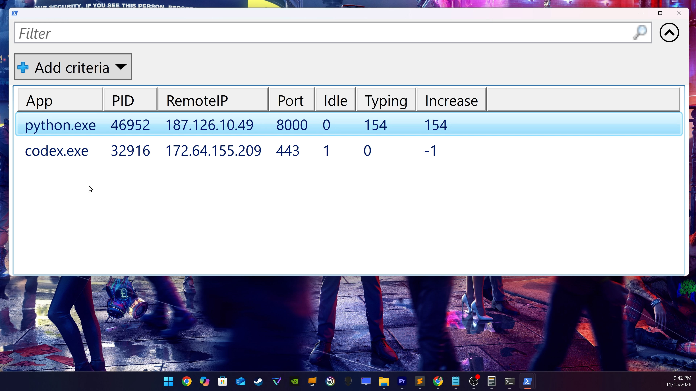

# Simple Keylogger Detection Lab

A Windows lab for comparing outbound connection activity during 30 seconds of idle time and 30 seconds of typing. 

For this experiment:
- **Your own test machine:** Run the keylogger on a computer you own or have permission to test.
- **Synthetic input:** Type fake passwords, made-up credit card numbers, and dummy messages instead of real sensitive information.

## Repository layout

```text
Simple_Keylogger/
├── logger/
│   ├── logger.py
│   └── requirements.txt
├── server/
│   ├── server.py
│   └── Dockerfile
├── README.md
└── LICENSE
```

## Windows environment

Open **Anaconda Prompt**:

```bat
conda create -n keylogger_lab python=3.12 -y
conda activate keylogger_lab
pip install -r logger/requirements.txt
```

The supplied Python files are a controlled demonstration. Do not run a keystroke collector against other people's data or publish a live collection endpoint. Instead, run the end point locally, on a system port of your choice (instructions below).

## Run the Server Locally

In the video, I demonstrated how a keylogger transmits data to a remote server. In this lab, we'll run the server locally to keep everything on our computer.

**Requirements:** Docker Desktop installed and running.

### 1. Build the Docker Image

Open a terminal and navigate to the `server` folder:

```bash
cd server
docker build -t endpoint .
```

### 2. Start the Server

```bash
docker run -d --name endpoint -p 127.0.0.1:8000:8000 -v data:/app/data endpoint
```

This starts the server at `http://127.0.0.1:8000`, accessible only from your computer.

### 3. Use the Local Endpoint

For the local lab, replace the `<YOUR API ENDPOINT>` placeholder in `logger.py` with:

```python
"http://127.0.0.1:8000/activity"
```

### 4. Inspect the Collected Data

After running your test, check the JSONL file:

```bash
docker exec endpoint cat /app/data/activity.jsonl
```

The `activity.jsonl` file is created automatically when the server receives its first data.

### 5. Stop the Server

```bash
docker stop endpoint
```

Your recorded data is not deleted. To access it again, restart the container with `docker start endpoint`.

### 6. Delete the Server and Recorded Data (Optional)

To completely clean up your lab, run:

```bash
docker stop endpoint
docker rm endpoint
docker volume rm data
```

**Warning:** This permanently deletes all recorded keyboard activity stored in `activity.jsonl`.

## Detect outbound connections (Administrator PowerShell)

🚨 Important: The detection workflow below is designed for external network connections. It will not detect the local endpoint `(127.0.0.1)` configured in the previous section because **local traffic is excluded** by the script.

To reproduce the exact experiment shown in the video, the logger would have to communicate with a remote server — which is **NOT recommended**!

This section is intended to help you identify suspicious applications transmitting data while you type.

If you discover an unfamiliar process sending data every time you press a key, it's **NOT** part of this lab! Investigate it before taking action.

### 1. Enable connection auditing

```powershell
auditpol /get /subcategory:"Filtering Platform Connection"
auditpol /set /subcategory:"Filtering Platform Connection" /success:enable
```

This tells Windows to **start recording successful network connections** in the Security event log, so we can analyze them later.

### 2. Define the event reader

This reusable function reads the Windows Security log, filters out local traffic, and collects information about external network connections - including the application name, process ID, IP address, and port.

```powershell
function Get-Connections($start, $end) {
    Get-WinEvent -FilterHashtable @{
        LogName = 'Security'
        Id = 5156
        StartTime = $start
        EndTime = $end
    } -ErrorAction SilentlyContinue |
    ForEach-Object {
        $d = @{}
        foreach ($item in ([xml]$_.ToXml()).Event.EventData.Data) {
            $d[$item.Name] = $item.'#text'
        }
        if ($d.Direction -ne '%%14593') { return }
        if ($d.Protocol -ne '6') { return }
        $ip = $d.DestAddress
        if ($ip -match '^(127\.|10\.|192\.168\.|169\.254\.|172\.(1[6-9]|2[0-9]|3[01])\.|::1$|fe80:|ff)') {
            return
        }
        [PSCustomObject]@{
            App  = ($d.Application -split '\\')[-1]
            PID  = $d.ProcessID
            IP   = $ip
            Port = $d.DestPort
        }
    }
}
```

### 3. Record 30 Seconds Without Typing

Run this command in Administrator PowerShell, and **don't touch the keyboard until the terminal is released** (30 seconds):

```powershell
$idleStart = Get-Date; Start-Sleep -Seconds 30; $idleEnd = Get-Date
```

**Do not type anything for 30 seconds.** Windows will record network connections while your computer is idle.

### 4. Record 30 Seconds While Typing

Run this command and **immediately start typing for 30 seconds**, in any app you'd like. This gives us network activity to compare against the idle period.

```powershell
$typingStart = Get-Date; Start-Sleep -Seconds 30; $typingEnd = Get-Date
```

### 5. Collect the Recorded Connections

Run this command after both 30-second periods are complete:

```powershell
$idle = Get-Connections $idleStart $idleEnd
$typing = Get-Connections $typingStart $typingEnd
```

This collects the network connections recorded during each period so we can compare them.


### 6. Compare events

Run the following code to compare network activity during the two 30-second periods. It counts how many connections each application made while you were idle and while you were typing, then calculates the difference.

```powershell
$report = @($idle) + @($typing) |
    Where-Object { $_ } |
    Group-Object App, PID, IP, Port |
    ForEach-Object {
        $sample = $_.Group[0]
        $idleCount = @($idle | Where-Object {
            $_.App -eq $sample.App -and
            $_.PID -eq $sample.PID -and
            $_.IP -eq $sample.IP -and
            $_.Port -eq $sample.Port
        }).Count
        $typingCount = $_.Count - $idleCount
        [PSCustomObject]@{
            App = $sample.App
            PID = $sample.PID
            RemoteIP = $sample.IP
            Port = $sample.Port
            Idle = $idleCount
            Typing = $typingCount
            Increase = $typingCount - $idleCount
        }
    }
```

### 7. View the Report

Run this command to display the results in a table:

```powershell
$report | Sort-Object Increase -Descending | Out-GridView
```

**Important:** The report shows how many network connections each application made. An application connecting to the internet while you're typing isn't necessarily a keylogger. But if you press a ton of keys and an unfamiliar application makes a ton of connections, that's a **HUGE red flag**! Otherwise, it could be normal activity, but it's still worth investigating.

**Example report:**



### 8. Investigate the Suspicious Process

Found something suspicious? Let's find out what it is!

Replace `46952`, the PID from the example report above, with the actual PID from your report:

```powershell
Get-CimInstance Win32_Process -Filter "ProcessId = 46952" |
    Select-Object ExecutablePath, CommandLine
```

This shows where the program is installed and how it was launched.

**Example output:**

```text
ExecutablePath                                      CommandLine
--------------                                      -----------
C:\Users\goaim\miniconda3\envs\env_312\python.exe   python logger.py
```

We found it! The suspicious process is running `logger.py` using Python from a Miniconda environment.

Since the command doesn't show the script's full location, let's search for it.

If you can't find the full path to your Python script, search for it by filename:

```powershell
Get-ChildItem C:\Users -Filter logger.py -Recurse -File -ErrorAction SilentlyContinue |
    Select-Object FullName
```

This lists files named `logger.py`. Check which one belongs to the suspicious process.

### 9. Stop the Suspicious Process

Once you've identified the process, replace `46952` with its PID and stop it:

```powershell
Stop-Process -Id 46952 -Force
```

Then delete the malicious script from your computer once you've confirmed its location.

### 10. Disable Network Connection Auditing

We're done investigating! Turn off the auditing we enabled in Step 1:

```powershell
auditpol /set /subcategory:"Filtering Platform Connection" /success:disable
```

## Final Thoughts

And that's how you catch our keylogger in action!

This method is designed against keyloggers that transmit data with every keystroke. Others might collect keystrokes and send them later, so they won't be as easy to spot.